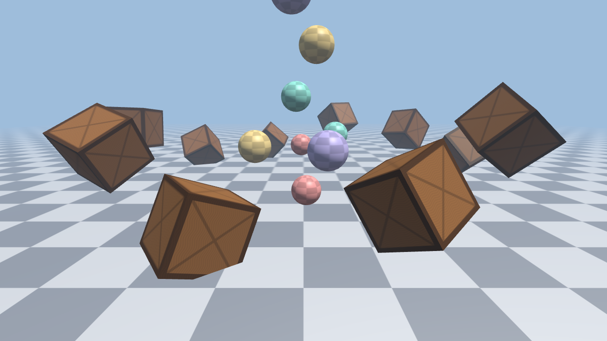

# OpenEngine

A small 3D engine in C++17 and OpenGL 3.3, with a demo scene: a ring of
spinning crates, balls that fall and bounce off the ground and each other,
and a free-flying camera.



*Rendered offscreen with `demo --screenshot`.*

## What is in it

| | |
|---|---|
| [`engine/Window`](engine/Window.h) | GLFW window and OpenGL context, keyboard and mouse state per frame |
| [`engine/Shader`](engine/Shader.h) | Compiles and links GLSL programs, reports compile errors with the log, caches uniform locations |
| [`engine/Mesh`](engine/Mesh.h) | Vertex and index buffers; generates cubes, planes and UV spheres |
| [`engine/Texture`](engine/Texture.h) | sRGB textures with mipmaps; generates checker and panel patterns |
| [`engine/Camera`](engine/Camera.h) | First-person fly camera: move, look, zoom |
| [`engine/Physics`](engine/Physics.h) | Fixed-time-step simulation of balls: gravity, bounces, ball-to-ball collisions |
| [`engine/Screenshot`](engine/Screenshot.h) | Saves the framebuffer as a BMP; renders offscreen with 4x MSAA |

## Design notes

- **Colour is handled in linear space.** Textures are uploaded as sRGB, so
  sampling returns linear values, lighting is computed on those, and the
  fragment shader converts the result back to sRGB.
- **Lighting** is Blinn-Phong from one directional light, plus ambient light
  that blends from a ground colour below to the sky colour above, and
  exponential fog that fades distant objects into the sky.
- **Physics runs at a fixed 120 steps per second**, independent of the frame
  rate. Leftover time carries over between frames, with a small tolerance
  so that frame times adding up to exactly N steps never lose one to
  rounding.
- **Collisions** between balls push them apart by mass (mass grows with
  volume) and exchange an impulse along the line between their centres. Tests
  check that momentum is conserved and that equal balls in a perfectly elastic
  collision swap speeds.
- **Offscreen rendering.** `--screenshot` creates a hidden window, renders into
  a multisampled framebuffer, resolves it and saves it, so images can be made
  without showing a window.

## Building

You need CMake 3.21 or newer and a C++17 compiler. GLFW, glm and doctest are
downloaded and built automatically; the glad OpenGL loader is in
`third_party/`.

```sh
cmake -S . -B build
cmake --build build --config Release
ctest --test-dir build -C Release      # physics tests
```

On Linux, GLFW needs the X11 development packages, for example
`libx11-dev libxrandr-dev libxinerama-dev libxcursor-dev libxi-dev`.

Run `build/Release/demo` (or `build/demo` on Linux), or render a single
frame with `demo --screenshot scene.bmp`.

## Controls

| | |
|---|---|
| Click | Capture the mouse to look around (<kbd>Esc</kbd> releases it) |
| <kbd>W</kbd> <kbd>A</kbd> <kbd>S</kbd> <kbd>D</kbd>, <kbd>Q</kbd> / <kbd>E</kbd> | Move, down / up |
| Scroll | Zoom |
| <kbd>Space</kbd> | Throw a ball |
| <kbd>R</kbd> | Drop a new set of balls |
| <kbd>↑</kbd> <kbd>↓</kbd> | Blend the crates between wood and steel |
| <kbd>F12</kbd> | Save a screenshot |

## Next

Shadow mapping, loading models from files, balls colliding with the crates,
and an in-game debug panel.
